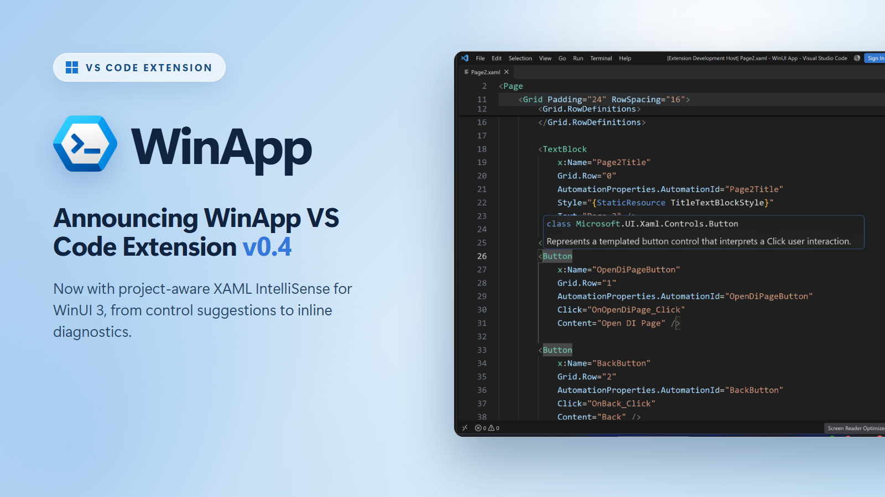

# Announcing XAML IntelliSense Support in the WinApp VS Code Extension



From creating your first project to writing UI and debugging with package identity, the WinApp extension helps you build Windows apps right in VS Code. It combines language support for app manifests with tools to create, run, debug, package, and sign your app, bringing more of your everyday development workflow into the editor.

**Get it now:** Install the [WinApp extension from the VS Code Marketplace](https://marketplace.visualstudio.com/items?itemName=Microsoft-WinAppCLI.winapp).

We're excited to announce the release of v0.4. This release brings project-aware IntelliSense to your WinUI 3 XAML, adds a command for creating new WinUI apps, and lets you build and run projects directly from VS Code.

## IntelliSense for WinUI XAML

Your XAML defines your app's UI: the controls on a page, the resources they share, and the bindings that connect them to your code. Editing it should come with more than syntax highlighting.

With v0.4, we're introducing a XAML language service for WinUI. It understands your app's types, referenced projects, and resources, so the suggestions you see reflect the project you're actually working on.

### Suggestions That Know Your Project

XAML IntelliSense in the WinApp extension supports:

- **Element autocompletion**: Suggests WinUI controls and your own custom controls. When a custom control needs a namespace, the extension can add the `xmlns` declaration for you.
- **Property and event autocompletion**: Suggests properties, events, and attached properties for the current element.
- **Value autocompletion**: Suggests enum and Boolean values, markup extensions, and resource keys.
- **Hover information**: Shows type and member information for elements, properties, and resource references without leaving the file.

**[VIDEO PLACEHOLDER: Add a WinUI control, complete its properties and values, then insert a custom control and show the automatically added namespace.]**

### Catch Errors and Fix Them in Place

The language service checks your XAML as you type, reporting malformed XAML and semantic errors against your project's resolved types. That means problems such as an unresolved type or an invalid `x:Bind` path can show up in the editor rather than waiting for your next build.
Press **Ctrl+.** to see available fixes.

### Follow Your XAML Into Your Code

Use **F12** or **Ctrl+Click** to jump from an event handler or `x:Bind` member to its C# declaration, or navigate to an `x:Name` or resource-key declaration. **Find All References** and **Rename** are also available for XAML names and resource keys.

For framework and NuGet types that only exist as compiled metadata, use hover to inspect them; Go to Definition does not open source for those types.

### Getting Started

Open a `.xaml` file in your WinUI project. XAML IntelliSense is on by default when the WinApp extension is installed.

**Full project-aware support is available for C# WinUI 3 projects and requires the .NET 10 SDK.** The language server itself ships as a self-contained native executable, so no separate runtime installation is needed to start it.

For **C++/WinRT**, this release provides formatting, folding, outline, automatic closing tags, document links, and syntax diagnostics. Full XAML intellisense support for C++ WinUI projects is coming soon; track its progress on our [GitHub repo](https://github.com/microsoft/WinAppVSCE/issues/222).

Features become available in stages: basic editing first, then SDK and package types, then your own types and semantic diagnostics. The status bar shows loading progress and calls out missing prerequisites or project-loading problems.

**[IMAGE PLACEHOLDER: XAML open beside its C# code-behind, with the status bar showing project-loading progress.]**

You can turn off the language service with `winapp.xaml.intelliSense.enable`, or keep completions while filtering diagnostic underlines with `winapp.xaml.diagnostics.level`. For IntelliSense in `.xaml.cs` code-behind, install [C# Dev Kit](https://marketplace.visualstudio.com/items?itemName=ms-dotnettools.csdevkit).

The language server supports Windows x64 and ARM64. If it cannot start, the extension keeps syntax highlighting available and explains the cause in a notification.

## Create a WinUI App Without Leaving VS Code

Until now, **WinApp: Initialize Project** assumed you already had a project. With v0.4, you can start one from the Command Palette.

Run **WinApp: Create WinUI App**, choose an official Windows App SDK template, give your app a name, and choose its parent folder. The extension creates the project and reports where it was saved. You don't need a folder or workspace open to get started.

Templates come from the WinApp CLI rather than a fixed list in the extension. The template pack is installed on first use; if you already have one installed, you can choose to keep it or install the latest version.

Scaffolding requires the [.NET SDK](https://dotnet.microsoft.com/download) 8.0.100 or later.

## Build, Run, and Debug From Your Project

**WinApp: Run Application** previously asked you to find a folder containing your built executable. In v0.4, it can discover runnable .NET projects and solutions and let the extension restore, build, and launch the app with package identity.

The extension searches for runnable projects and solutions first, falling back to build output folders when none are found. If there are several targets, you can choose from a Quick Pick. **Browse...** remains available for anything that wasn't listed.

**[VIDEO PLACEHOLDER: Open a WinUI project, run Run Application without locating a build output folder, and show the app building and launching.]**

The same project support is available when you press **F5**. In `launch.json`, the new `input` property accepts a project, solution, or build output folder. Point it at your project to restore and build before each launch:

```json
{
    "type": "winapp",
    "request": "launch",
    "name": "WinApp: Launch and Attach",
    "input": "${workspaceFolder}\\MyApp.csproj"
}
```

For more control, **WinApp: Run Application With Options...** prompts for the build configuration, target architecture, and run options such as skipping the build, cleaning app data, detaching, or unregistering the development package on exit. Persistent build and debug settings belong in `launch.json`, which now also supports target frameworks, runtime identifiers, MSBuild properties, and Native AOT launches for projects configured for AOT.

Already-built output folders still work as before, including for non-.NET apps. They launch without a build, so rebuild first or use a `preLaunchTask` when debugging. Native-only solutions use their built output rather than the .NET project-build path.

## More Improvements in v0.4

### AppxManifest Visual Editor

- **Image resolution:** Resource-qualified assets are recognized instead of incorrectly reported as missing.
- **Editor state:** XML edits preserve your selected tab, expanded fields, and scroll position, even through temporary parse errors.
- **Documentation links:** Microsoft Learn links respect your language preferences instead of forcing English.

### Signing and Certificates

- **Signing lists:** Packages appear first, with up to 10 recent results and **Browse...** for other files.
- **Certificate publisher:** Uses the manifest's publisher when available, or prompts you to enter one.
- **Existing certificates:** Choose to reuse or overwrite an existing development certificate.

## Get Started

The **WinApp VS Code extension** is available in public preview on the [Visual Studio Code Marketplace](https://marketplace.visualstudio.com/items?itemName=Microsoft-WinAppCLI.winapp).

**Install from VS Code:**

1. Open VS Code
2. Go to the Extensions view (`Ctrl+Shift+X`)
3. Search for **WinApp**
4. Click **Install**

Or from the command line:

```shell
code --install-extension Microsoft-WinAppCLI.winapp
```

**Requirements:**

- Windows 10 or later and Visual Studio Code 1.109.0 or later
- Windows x64 or ARM64 and the .NET 10 SDK for full C# WinUI 3 XAML IntelliSense
- The .NET SDK 8.0.100 or later for **Create WinUI App**
- For debugging, the debugger extension matching your app's language: C#, C/C++, or built-in Node.js

The WinApp CLI is bundled with the extension; no separate CLI installation is required.

## We Want Your Feedback

This is still a **public preview**, and your feedback directly shapes what we build next. Whether IntelliSense is missing a XAML scenario you rely on, a project didn't appear in the run picker, or you have an idea to make the workflow smoother, we want to hear it.

- [File a bug](https://github.com/microsoft/WinAppVSCE/issues)
- [Open a feature request](https://github.com/microsoft/WinAppVSCE/issues)
- Browse [open extension issues](https://github.com/microsoft/WinAppVSCE/issues) to upvote and comment on what matters to you

Happy coding!
